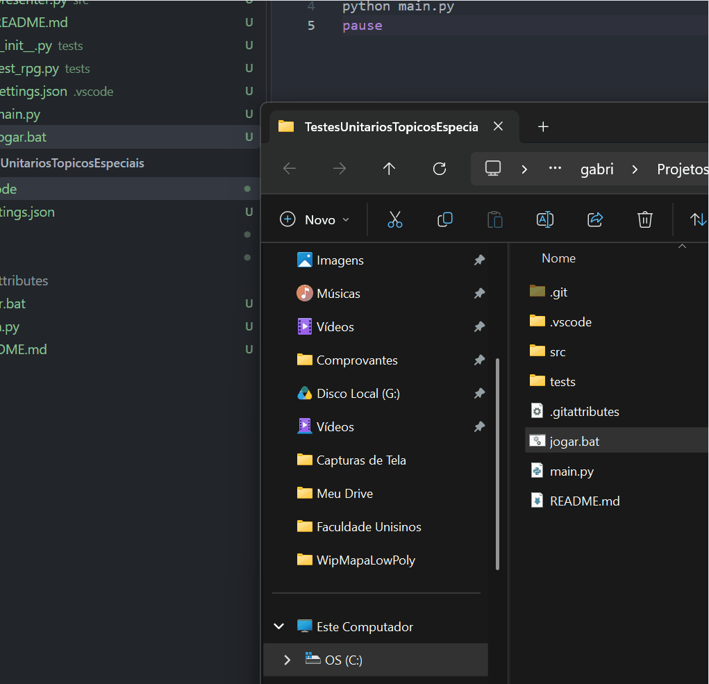

```
========================================================
   [MODULO: DOCUMENTACAO DE SISTEMA]
========================================================

> [IDENTIFICACAO DO PROJETO]

  >>Trabalho prático desenvolvido para a disciplina de Tópicos Especiais em Jogos Digitais (Unisinos). 
  O objetivo principal é demonstrar a aplicação de Testes Unitários e de Integração, 
  isolando as regras de negócio em classes puras desacopladas de qualquer motor gráfico ou interface.

  SISTEMA: Testabilidade em Jogos (Arquitetura MVP)
  DISCIPLINA: Topicos Especiais em Jogos Digitais
  INSTITUICAO: Unisinos

> [ESTRUTURA DE DIRETORIOS]
  TestesUnitariosTopicosEspeciais/
  ├── .vscode/
  │   └── settings.json        # Configuracao do Test Runner (unittest)
  ├── src/
  │   ├── __init__.py
  │   ├── model.py             # Classes puras (Logica de Combate e Inventario)
  │   ├── presenter.py         # Camada Presenter (Interligacao Model <-> View)
  │   └── view.py              # Camada View (Interface terminal retro)
  ├── tests/
  │   ├── __init__.py
  │   └── test_rpg.py          # 6 Testes Unitarios (AAA + Edge Cases + Mocks)
  └── main.py                  # Ponto de entrada (Loop principal do jogo)

> [ARQUITETURA // MODEL-VIEW-PRESENTER]
  - model.py    : Logica pura do heroi, calculos de incursao, abates e inventario.
  - presenter.py: Intermedia eventos disparados pelo Model e atualiza a View.
  - view.py     : Renderiza os relatorios de combate formatados.

> [COBERTURA DE TESTES UNITARIOS]
  Arquivo: tests/test_rpg.py (Padrao AAA: Arrange-Act-Assert)
  [1] Regra de Combate      : Validacao de abates, dano sofrido e coleta de loot.
  [2] Buffs e Progressao    : Uso de pocao de dano para elevar poder de fogo.
  [3] Edge Case (HP Minimo) : Garantia de que o HP trava em 0 (morte em combate).
  [4] Edge Case (HP Maximo) : Garantia de que o uso de pocao respeita o teto de HP.
  [5] Edge Case (Excecoes)  : Recusa de itens com mochila cheia e ValueError.
  [6] Integracao com Mocks  : Simulacao (MagicMock) para validar fluxo do Presenter.

> [EXECUCAO // JOGO E TESTES]
  - Iniciar Jogo (Terminal):
    python main.py

  - Executar Testes (CLI):
    python -m unittest discover -s tests -p "test_*.py" -t . -v

========================================================
```
<p align="center">
  
</p>
```
========================================================```